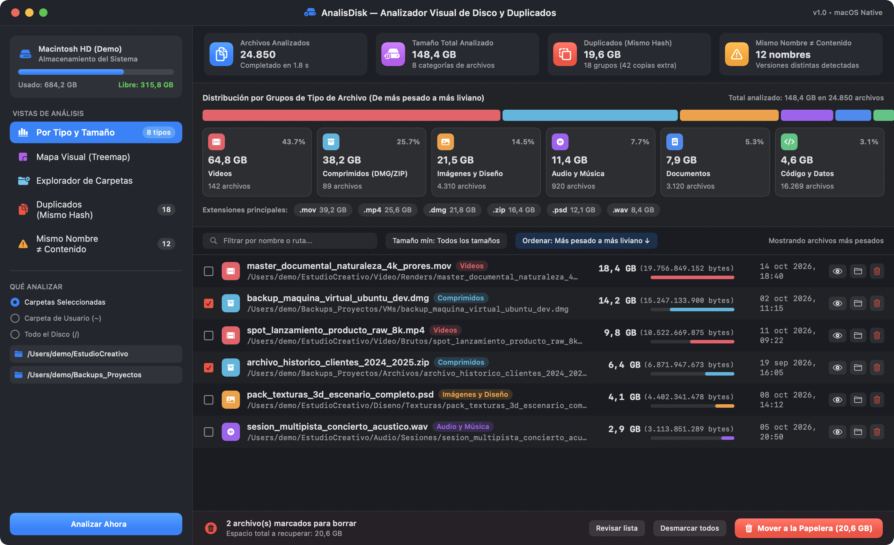
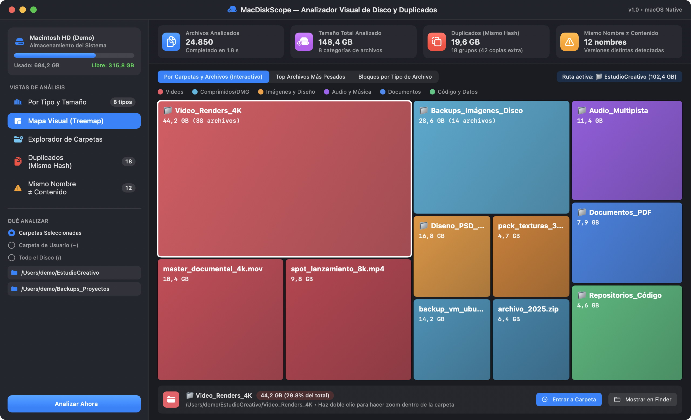
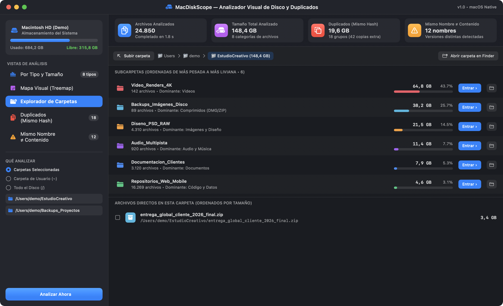
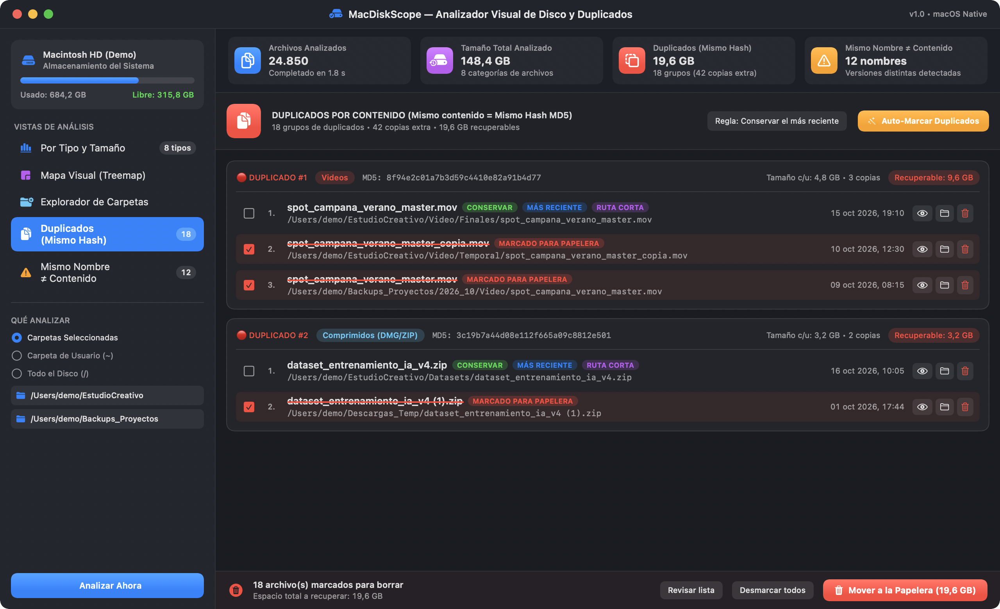
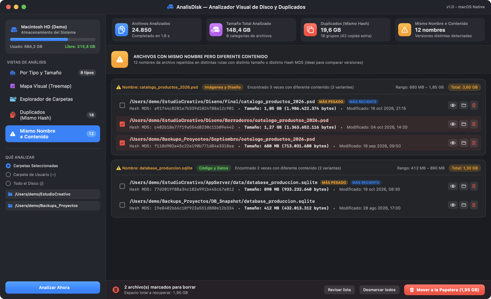
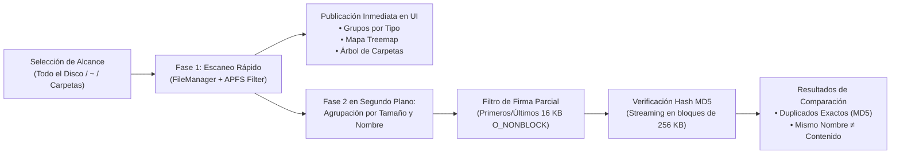

#  AnalisDisk — Analizador Visual de Almacenamiento y Comparador de Archivos para macOS

<p align="center">
  
</p>

**AnalisDisk** es una aplicación gráfica nativa para **macOS** construida en **Swift y SwiftUI** (junto con su utilidad original de línea de comandos `analyze_dupes.py`) diseñada para inspeccionar de forma ultrarrápida qué archivos y carpetas están consumiendo el almacenamiento de tu Mac, agruparlos por **categoría de tipo de archivo** y ordenarlos del **más pesado al más liviano**, además de detectar **duplicados exactos por contenido (Hash MD5)** y **archivos con el mismo nombre pero diferente contenido** para decidir qué enviar de forma segura a la Papelera.

---

##  Características Principales

- **◈ Alcance Flexible de Análisis**
  - **Todo el Disco (`/`)**: Escanea todo el volumen principal de macOS evitando contar doble los *firmlinks* de APFS (`/System/Volumes/Data`) y archivos virtuales del sistema.
  - **Carpeta de Usuario (`~`)** y **Accesos Rápidos**: Botones de un clic para analizar *Descargas*, *Documentos*, *Escritorio*, *Aplicaciones*, *Usuario (`~`)* o *Todo el Disco (`/`)*.
  - **Selección Múltiple de Carpetas**: Permite elegir una o varias carpetas personalizadas al mismo tiempo (por ejemplo, comparar una carpeta de trabajo con un disco externo de respaldos).
- **◈ Agrupación por Tipo de Archivo y Orden por Tamaño**
  - Clasifica automáticamente cada archivo en **8 grupos visuales**: *Videos*, *Imágenes y Diseño*, *Audio y Música*, *Comprimidos e Imágenes de Disco (DMG/ZIP)*, *Documentos y Ofimática*, *Código y Datos*, *Aplicaciones y Binarios* y *Otros*.
  - Desglose rápido por extensión individual (`.mov`, `.mp4`, `.dmg`, `.zip`, `.psd`, `.pdf`, etc.) y filtros por tamaño mínimo (`> 1 MB`, `> 10 MB`, `> 100 MB`, `> 500 MB`, `> 1 GB`).
- **◈ Mapa Visual de Bloques Interactivos (Treemap)**
  - Visualización proporcional estilo *DaisyDisk / GrandPerspective* donde el área de cada bloque representa su peso real en disco y su color identifica su tipo de archivo.
  - Permite hacer *zoom* dentro de cualquier carpeta con navegación por ruta (*breadcrumbs*) y menú contextual directo.
- **◈ Explorador Jerárquico de Carpetas**
  - Muestra cuánto pesa cada carpeta y subcarpeta en forma acumulativa, ordenadas de la más pesada a la más liviana con barras de porcentaje relativo.
- **◈ Detección Ultrarrápida de Duplicados por Contenido (Mismo Hash MD5)**
  - Evolución gráfica y optimizada de la Sección 1 de `analyze_dupes.py`.
  - Pre-filtra por tamaño exacto + firma parcial rápida (`O_NONBLOCK` en los primeros y últimos 16 KB) antes de calcular el Hash MD5 en bloques de 256 KB, logrando analizar decenas de miles de archivos en segundos sin bloquear la interfaz ni descargar archivos en la nube (*iCloud Drive / OneDrive*).
  - **Auto-Selección Inteligente con 1 clic**: Marca automáticamente las copias redundantes conservando siempre una copia segura según la regla elegida (*Conservar el más reciente*, *Conservar el más antiguo*, *Conservar la ruta más corta* o *Conservar la ruta más larga*).
- **◈ Comparador de Archivos con Mismo Nombre pero Diferente Contenido**
  - Evolución gráfica de la Sección 2 de `analyze_dupes.py`.
  - Detecta archivos que se llaman igual en distintas carpetas pero tienen **diferente tamaño o diferente Hash MD5**, resaltando con insignias cuál es la versión **MÁS PESADA** y cuál es la **MÁS RECIENTE**.
- **◈ Limpieza Segura Integrada con macOS**
  - Carrito de selección con cálculo en tiempo real ($O(1)$) del espacio total a recuperar.
  - Envía los archivos seleccionados a la **Papelera (Trash) oficial de macOS** (`FileManager.default.trashItem`), permitiendo restaurarlos en cualquier momento si cambias de opinión.
  - Botones directos en cada fila para **Mostrar en Finder** y **Abrir / Vista Previa**.

---

##  Recorrido Visual por las 5 Funciones del Programa

> *Nota: Todas las capturas de pantalla a continuación utilizan rutas y archivos de demostración 100% ficticios (`/Users/demo/EstudioCreativo/...`).*

### 1.  Distribución por Tipo de Archivo y Lista de Mayor a Menor Tamaño
Muestra la barra de proporción multicolor del almacenamiento analizado, tarjetas interactivas por cada categoría de archivo, sub-filtros por extensión y la lista de archivos ordenada estrictamente desde el más pesado hasta el más liviano.


---

### 2.  Mapa Visual de Bloques Proporcionales (Treemap)
Representa gráficamente el espacio ocupado mediante bloques proporcionales coloreados por categoría. Puedes alternar entre **Por Carpetas y Archivos (Interactivo)**, **Top Archivos Más Pesados** y **Bloques por Tipo de Archivo**, hacer doble clic en cualquier carpeta para explorar su interior o usar el inspector inferior.



---

### 3.  Explorador Jerárquico de Carpetas
Permite recorrer el árbol de directorios viendo el peso acumulado de cada subcarpeta y su porcentaje respecto a la carpeta padre, ordenadas siempre de mayor a menor impacto en disco.



---

### 4.  Duplicados Exactos por Contenido (Mismo Hash MD5 + Auto-Selección)
Agrupa todos los archivos que tienen exactamente el mismo contenido binario (mismo Hash MD5), ordenados según el **espacio desperdiciado recuperable**. Incluye el botón **Auto-Marcar Duplicados** para seleccionar automáticamente todas las copias sobrantes respetando el archivo original más reciente o de ruta más corta.



---

### 5.  Archivos con Mismo Nombre pero Diferente Contenido
Encuentra archivos que comparten exactamente el mismo nombre (por ejemplo, distintos respaldos o borradores de un proyecto en carpetas diferentes) pero cuyo contenido o tamaño ha cambiado, mostrando su Hash MD5, rango de tamaños, fechas de modificación y etiquetas de **MÁS PESADO** y **MÁS RECIENTE** para que decidas qué versión conservar.



---

##  Arquitectura y Flujo de Análisis en Dos Fases

Para garantizar que la interfaz gráfica jamás se bloquee al analizar discos completos o carpetas con cientos de miles de archivos, **AnalisDisk** ejecuta un motor asíncrono en dos fases:



---

##  Requisitos e Instalación en macOS

### Requisitos del Sistema
- **▸ Sistema Operativo**: macOS 14.0 (Sonoma) o superior (compatible con macOS 15 Sequoia en Intel y Apple Silicon).
- **▸ Compilador**: Xcode Command Line Tools (`swiftc` incluido en macOS).
  - Si no tienes las herramientas de línea de comandos instaladas, ejecuta en Terminal:
    ```bash
    xcode-select --install
    ```

### Compilación y Ejecución de la App Gráfica (`AnalisDisk.app`)

1. **Clonar el repositorio y entrar a la carpeta del proyecto**:
   ```bash
   git clone <URL_DEL_REPOSITORIO>
   cd analis-disk
   ```

2. **Compilar el paquete nativo `.app`**:
   Ejecuta el script de construcción incluido:
   ```bash
   chmod +x build.sh
   ./build.sh
   ```
   Esto compilará los módulos de `Sources/` con optimización `-O` y generará el paquete **`AnalisDisk.app`** en la raíz del proyecto.

3. **Abrir la aplicación**:
   ```bash
   open AnalisDisk.app
   ```
   *(Opcional)* Puedes arrastrar **`AnalisDisk.app`** directamente a tu carpeta **`/Applications` (Aplicaciones)** en Finder para tenerla siempre disponible desde Launchpad o Spotlight.

> [!TIP]
> **Permisos de Acceso Total al Disco (Full Disk Access)**: Si deseas analizar **Todo el Disco (`/`)** o carpetas protegidas de macOS, puedes otorgar permiso a `AnalisDisk.app` en *Ajustes del Sistema → Privacidad y seguridad → Acceso total al disco*.

---

##  Uso del Script Original de Línea de Comandos (`analyze_dupes.py`)

El proyecto conserva también el script original en Python (`analyze_dupes.py`) para ejecuciones rápidas por terminal en el directorio actual:

```bash
python3 analyze_dupes.py
```

---

##  Estructura del Proyecto

```text
analis-disk/
├── Sources/
│   ├── AnalisDiskApp.swift       # Punto de entrada @main y configuración de ventana macOS
│   ├── Models.swift              # Modelos de datos, categorías de archivo, nodos y formateadores
│   ├── DiskScanner.swift         # Motor asíncrono de escaneo, árbol de carpetas, MD5 y Papelera
│   ├── ContentView.swift         # Barra lateral, métricas superiores y carrito de Papelera
│   ├── CategoryAndFilesView.swift# Vistas Por Tipo y Tamaño + Explorador Jerárquico de Carpetas
│   ├── TreemapView.swift         # Algoritmo y lienzo interactivo del Mapa Visual (Treemap)
│   └── DuplicatesView.swift      # Vistas de Duplicados por Hash MD5 y Mismo Nombre ≠ Contenido
├── docs/
│   ├── icons/                    # Iconos vectoriales minimalistas monocromáticos (SVG)
│   └── images/                   # Capturas de pantalla demostrativas con datos ficticios
├── analyze_dupes.py              # Script original en Python para análisis en consola
├── build.sh                      # Script de compilación nativa de AnalisDisk.app
└── README.md                     # Documentación visual del proyecto
```
